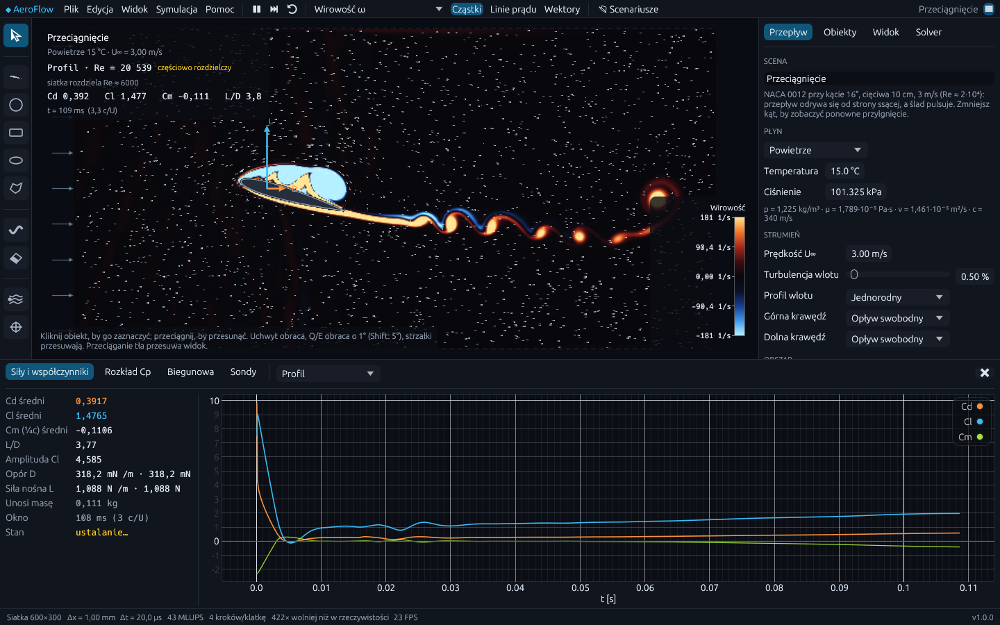

# AeroFlow — interaktywny tunel aerodynamiczny 2D

Natywna aplikacja (Rust) do symulacji opływu ciał w czasie rzeczywistym — metodą siatkową Boltzmanna, **w jednostkach fizycznych**.
Rysujesz profile lotnicze, walce, budynki czy samochód, wybierasz płyn, temperaturę i prędkość, a program liczy przepływ, siły w niutonach,
współczynniki Cd/Cl/Cm, liczbę Strouhala, rozkład ciśnienia na powierzchni i biegunową profilu. Każdy wynik ma ocenę wiarygodności,
która mówi wprost, czy przy danej rozdzielczości i liczbie Reynoldsa jest ilościowy, czy tylko jakościowy.



## Instalacja

Pobierz najnowsze wydanie ze strony [Releases](https://github.com/BlackSingularities/aeroflow/releases):

| Plik | Opis |
| --- | --- |
| `AeroFlow-Setup-X.Y.Z.exe` | instalator Windows (menu Start, skrót, skojarzenie plików `.aeroflow`, deinstalator) |
| `AeroFlow-X.Y.Z-windows-x64-portable.exe` | wersja przenośna — jeden plik, bez instalacji |
| `AeroFlow-X.Y.Z-linux-x64.tar.gz` | Linux x64 |

Instalator domyślnie instaluje program dla bieżącego użytkownika (bez uprawnień administratora), więc aktualizacje nie wymagają potwierdzania UAC.
Wersja przenośna to jeden plik `.exe` — wystarczy go uruchomić.
Plik nie jest podpisany certyfikatem, dlatego przy pierwszym uruchomieniu Windows SmartScreen może pokazać ostrzeżenie („Więcej informacji → Uruchom mimo to”).

### Aktualizacje

Przy starcie program sprawdza w tle najnowsze wydanie na GitHubie. Gdy jest nowsza wersja, pojawia się pasek z informacją, opisem zmian
i przyciskiem **Pobierz i zainstaluj**: instalator jest pobierany, weryfikowany sumą SHA-256, a program zamyka się, aktualizuje i uruchamia ponownie
(niezapisana scena jest przywracana). Po aktualizacji wyświetla się okno „Co nowego”. Sprawdzanie można wyłączyć w menu *Pomoc*.

> Sprawdzanie aktualizacji korzysta z publicznego API GitHub Releases — działa, gdy repozytorium (lub repozytorium z wydaniami
> wskazane przy kompilacji zmienną `AEROFLOW_UPDATE_REPO=właściciel/repo`) jest publiczne.

## Interfejs

- **Górny pasek** — scenariusz (📂), Start / Pauza, wybór pola (Prędkość, Ciśnienie, Wirowość, Dym, Więcej), nakładki,
  wykresy, panel i menu ☰.
- **Pasek narzędzi** po lewej — Zaznacz, ciała (profil, walec, prostokąt, elipsa, dowolny kształt), ściany (pędzel, gumka),
  pomiar (źródło dymu, sonda). Podpowiedź aktywnego narzędzia jest na dole widoku.
- **Inspektor** po prawej — od góry: wyniki dla głównego ciała, zaznaczony obiekt (wymiary, kąt natarcia), warunki przepływu;
  niżej zwinięte sekcje *Obszar i brzegi*, *Wyświetlanie* i *Obliczenia*.

## Obliczenia na GPU

Solver działa na karcie graficznej przez wgpu (Vulkan, DirectX 12, Metal). Populacje siatki są cały czas w pamięci karty,
a do interfejsu wracają tylko prędkość, ciśnienie i siły raz na klatkę. Na RTX 4070 Ti to ok. 4800 MLUPS (milionów
aktualizacji komórek na sekundę) wobec ok. 300 MLUPS na procesorze, więc można liczyć gęstsze siatki — sekcja
*Obliczenia → Rozdzielczość* pozwala na 900 i więcej komórek na wysokość. Karta jest używana automatycznie; bez obsługiwanej karty (albo gdy przestanie odpowiadać) program sam i bez przerwy
przechodzi na procesor. Pasek stanu pokazuje, co liczy.

Domyślne tempo **Płynne** jest takie samo na każdym komputerze: strumień przechodzi przez widok w ok. 8 s, więc ruch
wirów i cząstek da się spokojnie oglądać. Tempo **Maksymalne** (sekcja *Obliczenia*) liczy tak szybko, jak pozwala
sprzęt — przydaje się, gdy trzeba szybko uzyskać ustalone wyniki.

## Fizyka

| | |
| --- | --- |
| Metoda | Lattice-Boltzmann D2Q9, kolizja BGK z regularyzacją, osobna lepkość objętościowa tłumiąca akustykę, model podsiatkowy Smagorinsky'ego (LES) — w przepływach rozdzielczych jego wkład zanika |
| Ciała | interpolowane odbicie Bouzidiego z dokładną odległością ściany (2. rząd dokładności na krzywych brzegach) |
| Siły | metoda wymiany pędu dla każdego ciała osobno, z momentem pochylającym względem osi obrotu (¼ cięciwy profilu) |
| Płyny | powietrze (gaz doskonały, wzór Sutherlanda), woda (równania Thiesena i Vogela), płyn własny |
| Brzegi | opływ swobodny (niewidoczne marginesy ze strefami pochłaniającymi), ściana tunelu, ściana bez tarcia, ruchoma podłoga |
| Wlot | profil jednorodny, kanałowy (Poiseuille) lub potęgowy warstwy przyziemnej; syntetyczna turbulencja o zadanej intensywności |

Wszystkie parametry wejściowe są fizyczne. Program dobiera krok czasu tak, by prędkość w jednostkach siatki była mała (błąd ściśliwości ∝ Ma²),
a lepkość siatki odpowiadała dokładnie liczbie Reynoldsa układu rzeczywistego.

**Ograniczenia** (opisane też w programie: *Pomoc → Model fizyczny*): przepływ jest dwuwymiarowy i nieściśliwy; przy bardzo dużych liczbach
Reynoldsa warstwa przyścienna jest cieńsza od komórki siatki, więc opór i maksymalna siła nośna są jakościowe. Gdy lepkość płynu jest
mniejsza niż najmniejsza lepkość stabilna na danej siatce (τ ≥ 0,503), solver dodaje minimalną lepkość numeryczną i program pokazuje
**efektywną liczbę Reynoldsa siatki** obok rzeczywistej. Wskaźnik **Wiarygodność** (DNS — rozdzielczy / częściowo rozdzielczy /
LES — jakościowy) informuje, jak traktować wynik.

### Walidacja

Scenariusze z grupy *Walidacja* mają wartości z literatury, a panel *Siły* porównuje z nimi wynik po ustaleniu przepływu:
walec przy Re = 20, 100 i 200 (Cd, amplituda Cl, liczba Strouhala) oraz pręt kwadratowy przy Re = 100.
Testy automatyczne sprawdzają m.in. profil Poiseuille'a w kanale, opór walca przy Re = 20, rozkład ciśnienia na profilu
NACA 0012 oraz zgodność jądra GPU z jądrem CPU.

Skala kolorów ciśnienia jest fizyczna: biel to ciśnienie otoczenia, czerwień — spiętrzenie (Cp = 1), błękit — ssanie.
Na profilu o grubości 12 % podciśnienie występuje w środkowej części cięciwy po **obu** stronach (Cp ≈ −0,35 przy α = 0°);
siła nośna bierze się z tego, że przy dodatnim kącie natarcia strona górna ssie mocniej, a pod przednią częścią dolnej
powierzchni powstaje nadciśnienie.

## Funkcje

- **Narzędzia:** profil NACA (dowolne oznaczenie 4-cyfrowe), walec, prostokąt z zaokrągleniem, elipsa, dowolny kształt, pędzel ścian z gumką, źródła dymu, sondy pomiarowe.
- **Edycja:** przesuwanie, obrót uchwytem / kółkiem / klawiszami, menu kontekstowe, panel właściwości z wymiarami w metrach, blokowanie, odbicie, cofanie i ponawianie.
- **Pola:** prędkość i jej składowe, wirowość, ciśnienie (Pa) i Cp, kryterium Q, dym, pola uśrednione w czasie, intensywność turbulencji, lepkość turbulentna.
- **Nakładki:** cząstki ze śladami, linie prądu o równym odstępie, wektory prędkości, wektory sił, legenda z jednostkami, odczyt wartości pod kursorem.
- **Analiza:** historia Cd/Cl/Cm, średnie po pełnych okresach, częstotliwość odrywania wirów i liczba Strouhala, rozkład Cp na powierzchni,
  automatyczna **biegunowa** profilu (Cl(α), Cd(α), Cm(α), Cl(Cd)), sondy z widmem częstotliwości, liczba kawitacji dla wody.
- **Pliki:** zapis i odczyt scen `.aeroflow`, eksport CSV (siły, biegunowa, sondy, całe pole), zrzut widoku PNG.
- **Scenariusze:** profil NACA 2412, przeciągnięcie, klapa szczelinowa, samochód nad ruchomą podłogą, płyta, ścieżka Kármána w wodzie,
  walidacja walca i pręta kwadratowego, wiatr w zabudowie miejskiej, zwężka Venturiego, uskok, tandem walców.

### Skróty klawiszowe

| Klawisz | Działanie |
| --- | --- |
| `Spacja` / `.` / `R` | pauza / jeden krok / reset przepływu |
| `1` … `0` | narzędzia |
| `V`, `Shift+V` | następne / poprzednie pole |
| `P` / `L` | cząstki / linie prądu |
| `Del`, `Ctrl+D` | usuń / duplikuj zaznaczony obiekt |
| `Q` / `E` (z `Shift`: 5°), `Alt` + kółko | obrót |
| strzałki (z `Shift`: ×10) | przesunięcie o komórkę |
| kółko myszy, środkowy przycisk, `Home` | powiększenie, przesuwanie, dopasowanie widoku |
| `Ctrl+Z` / `Ctrl+Y` | cofnij / ponów |
| `Ctrl+O` / `Ctrl+S` / `Ctrl+Shift+S` | otwórz / zapisz / zapisz jako |
| `K` | zrzut widoku PNG |
| `S` / `G` / `H` / `F11` | panel ustawień / wykresy / ukryj interfejs / pełny ekran |
| `F1` | lista skrótów |

## Budowanie ze źródeł

Wymagany Rust (stable, ≥ 1.85).

```bash
cargo run --release                       # uruchom
cargo run --release -- scena.aeroflow     # otwórz scenę
cargo run --release -- --preset karman --field vorticity
cargo test --release                      # testy (w tym fizyczne)
```

Instalator Windows: `cargo build --release`, a następnie `ISCC.exe /DAppVersion=1.0.0 installer\aeroflow.iss` (Inno Setup 6) — plik trafia do `dist/`.

## Wydania (automatyczne)

Workflow `.github/workflows/release.yml` uruchamia się przy każdym pushu do `main`, który zmienia program:

1. testy na Linuksie i Windows (fmt, clippy, testy),
2. wyznaczenie wersji: wersja z `Cargo.toml`, jeśli nie ma jeszcze takiego tagu; w przeciwnym razie kolejny numer poprawki (`1.0.0 → 1.0.1`),
3. kompilacja Windows (instalator Inno Setup + wersja przenośna) i Linux,
4. publikacja wydania `vX.Y.Z` z sumami SHA-256 i opisem — sekcją z `CHANGELOG.md` dla tej wersji lub listą commitów od poprzedniego wydania.

Większą zmianę wersji ustawia się w `Cargo.toml` (z opisem w `CHANGELOG.md`) albo ręcznie: *Actions → Release → Run workflow* z wyborem `minor`/`major`.

## Struktura

```
src/physics/units.rs     własności płynów, przeliczanie jednostek, ocena wiarygodności
src/physics/geometry.rs  kształty ciał (NACA, walec, elipsa, prostokąt, wielokąt, ściana), triangulacja
src/physics/lattice.rs   solver LBM D2Q9 (rayon), warunki brzegowe, Bouzidi, siły, testy walidacyjne
src/sim.rs               wątek symulacji, dym, uśrednianie, publikacja klatek
src/analysis.rs          statystyki sił, Strouhal, sondy, widmo, biegunowa, rozkład Cp
src/scene.rs             scena, konfiguracja przepływu, scenariusze
src/render/              mapy kolorów, pola, cząstki i linie prądu
src/ui/                  widok, panele, wykresy, okna
src/update.rs            sprawdzanie i instalacja aktualizacji
installer/aeroflow.iss   instalator Inno Setup
```

Licencja: MIT.
